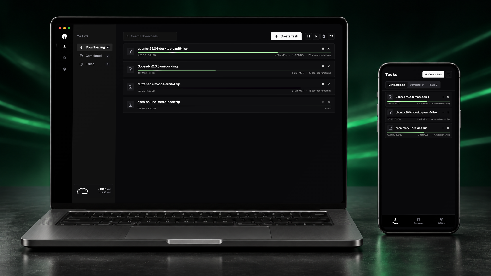

# [](https://gopeed.com)

[](https://github.com/GopeedLab/gopeed/actions?query=workflow%3Atest)
[](https://codecov.io/gh/GopeedLab/gopeed)
[](https://github.com/GopeedLab/gopeed/releases)
[](https://github.com/GopeedLab/gopeed/releases)
[](https://gopeed.com/docs/donate)
[](https://raw.githubusercontent.com/GopeedLab/gopeed/main/_docs/img/weixin.png)
[](https://discord.gg/ZUJqJrwCGB)

<a href="https://trendshift.io/repositories/7953" target="_blank"></a>

[公式サイト](https://gopeed.com) · [拡張機能ストア](https://gopeed.com/store) · [ダウンロード](https://gopeed.com/#downloads)

[English](/README.md) | [中文](/README_zh-CN.md) | [日本語](/README_ja-JP.md) | [正體中文](/README_zh-TW.md) | [Tiếng Việt](/README_vi-VN.md)

## 🚀 はじめに

**Gopeed は、デスクトップ、モバイル、Web で使えるモダンな高速ダウンロードマネージャーです。** 無料のオープンソースソフトウェアで、**HTTP、FTP、HLS、BitTorrent ファイル、マグネットリンク、ed2k** に対応しています。



## ✨ 主な機能

- ⚡ **高速ダウンロード** — 複数タスク、HTTP のマルチ接続分割転送、BitTorrent の P2P ダウンロードで帯域を最大限に活用します。
- 🧲 **マルチプロトコル** — HTTP/HTTPS、FTP/FTPS/FTPES、HLS、BitTorrent ファイル、マグネットリンク、ed2k リンクに対応します。FTP ではファイルとディレクトリをダウンロードでき、オンデマンド HLS（`.m3u8`）ではセグメントを 1 つの再生可能なファイルにまとめます。
- 🌱 **充実した BT 機能** — DHT によるピア検出、uTP 転送、Web Seed、ファイル選択、トラッカー管理（WebTorrent 対応）、Peer/ピース統計、共有率または時間によるシード制御。
- 📋 **タスク管理** — 一時停止、再開、再試行、一括操作、検索、状態フィルター、カテゴリ、起動時復元。
- 🪶 **軽量なネイティブ体験** — メイン UI は Flutter でネイティブ描画。Electron 非採用。WebView ラッパーでもありません。パッケージサイズと実行時オーバーヘッドを抑え、軽快な応答性を実現します。
- 💻 **クロスプラットフォーム** — Windows、macOS、Linux、Android、iOS、Web、Docker、QNAP に対応。
- 🎨 **カスタマイズ可能なテーマ** — システム連動、ライト、ダークの各モードと 8 色のアクセントカラーに対応。
- 📐 **レスポンシブ UI** — タスクリスト、ナビゲーション、設定、詳細画面がスマートフォン、タブレット、サイズ変更可能なデスクトップウィンドウに適応。
- 🗣️ **20 以上の UI 言語** — 日本語、英語、簡体字・繁体字中国語、韓国語など多くの言語に対応。
- 🌐 **ブラウザー連携** — Chrome、Edge、Firefox などのダウンロードを Gopeed に送信できます。
- 🧩 **JavaScript 拡張** — 動画サイト、AI モデルハブ、クラウドストレージなどのダウンロード元を追加できます。
- 🎬 **FFmpeg 内蔵** — JavaScript 拡張は、Gopeed に同梱された WebAssembly ランタイムで、別々の映像トラックと音声トラックを再エンコードせずに結合できます。
- 🤖 **AI 連携** — MCP インターフェースを通じて対応する AI Agent と連携し、自然言語でダウンロードタスクを作成・確認・管理できます。
- 🔌 **オープンなインターフェース** — REST API、CLI、認証付き Web UI、Webhook、完了後スクリプトに対応。
- 🛠️ **便利な内蔵機能** — カスタム Header/User-Agent、Proxy、GitHub ミラー、通知、自動展開。

## 🤖 AI 連携

Gopeed を AI Agent と連携すると、自然言語でダウンロードを管理できます。たとえば、AI Agent に次のように依頼できます：

> 最新の Gopeed Windows クライアントをダウンロードして

| Tool | 説明 |
| --- | --- |
| `resolve_task` | ダウンロード URL または URI を解析し、タスク作成前にリソース情報とファイル一覧を返します。 |
| `create_task` | 解析済みのリソース ID または直接のダウンロードリクエストからタスクを作成して開始します。 |
| `list_tasks` | タスクを一覧表示し、必要に応じて ID または状態で絞り込みます。 |
| `get_task` | 一つのタスクについて、リクエスト、リソース、オプション、現在の進捗を取得します。 |
| `get_task_status` | 一つのタスクの簡易的な実行状態とファイル別の進捗を取得します。 |
| `get_task_stats` | HTTP 接続数や BitTorrent の Peer・シード情報など、プロトコル固有の統計を取得します。 |
| `pause_task` | タスクを一時停止します。 |
| `continue_task` | 一時停止または失敗したタスクを再開します。 |
| `delete_task` | タスクを削除し、必要に応じてダウンロード済みファイルも削除します。 |

## ⬇️ インストール

- [公式サイトからダウンロード](https://gopeed.com)
- [GitHub Releases](https://github.com/GopeedLab/gopeed/releases/latest)

### 🛠️ コマンドツール

## 📱 WeChat 公式アカウント

公式アカウントをフォローして、最新のアップデートやニュースを入手してください。


## 💝 寄付

もしこのプロジェクトがお気に召しましたら、このプロジェクトの発展を支援するために[寄付](https://gopeed.com/docs/donate)をご検討ください！

## 👨‍💻 開発

Flutter アプリは `ui/flutter` にあります。Windows、macOS、Linux では Dart FFI を使い、Android と iOS ではプラットフォームチャネルと gomobile を使って Go コアを呼び出します。Flutter Web は Go の REST API を使います。ネイティブアプリでも外部連携用に REST API を有効にできます。

### 🌍 環境

1. Go 1.27.4
2. Flutter 3.41.6

### 📋 クローン

```bash
git clone git@github.com:GopeedLab/gopeed.git
```

### 🤝 コントリビュート

[CONTRIBUTING_ja-JP.md](CONTRIBUTING_ja-JP.md) をご参照ください

### 🏗️ ビルド

#### デスクトップ

まず、[flutter デスクトップ公式サイトドキュメント](https://docs.flutter.dev/development/platform-integration/desktop)に従って環境を設定し、自分で検索できる `cgo` 環境を用意します。

コマンド:

- windows

```bash
go build -tags nosqlite -ldflags="-w -s" -buildmode=c-shared -o ui/flutter/windows/libgopeed.dll github.com/GopeedLab/gopeed/bind/desktop
cd ui/flutter
flutter build windows
```

- macos

```bash
go build -tags nosqlite -ldflags="-w -s" -buildmode=c-shared -o ui/flutter/macos/Frameworks/libgopeed.dylib github.com/GopeedLab/gopeed/bind/desktop
cd ui/flutter
flutter build macos
```

- linux

```bash
go build -tags nosqlite -ldflags="-w -s" -buildmode=c-shared -o ui/flutter/linux/bundle/lib/libgopeed.so github.com/GopeedLab/gopeed/bind/desktop
cd ui/flutter
flutter build linux
```

#### モバイル

先ほどと同じように、`cgo` 環境を準備し、`gomobile` をインストールする必要があります:

```bash
go install golang.org/x/mobile/cmd/gomobile@latest
go get golang.org/x/mobile/bind
gomobile init
```

コマンド:

- android

```bash
gomobile bind -tags nosqlite -ldflags="-w -s -checklinkname=0" -o ui/flutter/android/app/libs/libgopeed.aar -target=android -androidapi 21 -javapkg="com.gopeed" github.com/GopeedLab/gopeed/bind/mobile
cd ui/flutter
flutter build apk
```

- ios

```bash
gomobile bind -tags nosqlite -ldflags="-w -s" -o ui/flutter/ios/Frameworks/Libgopeed.xcframework -target=ios github.com/GopeedLab/gopeed/bind/mobile
cd ui/flutter
flutter build ios --no-codesign
```

#### Web

コマンド:

```bash
cd ui/flutter
flutter build web
cd ../../
rm -rf cmd/web/dist
cp -r ui/flutter/build/web cmd/web/dist
CGO_ENABLED=0 go build -tags nosqlite,web -ldflags="-s -w" -o bin/ github.com/GopeedLab/gopeed/cmd/web
```

## ❤️ 感謝

### コントリビューター

<a href="https://github.com/GopeedLab/gopeed/graphs/contributors">
  
</a>

### JetBrains

[](https://www.jetbrains.com/?from=gopeed)

## ライセンス

[GPLv3](LICENSE)
